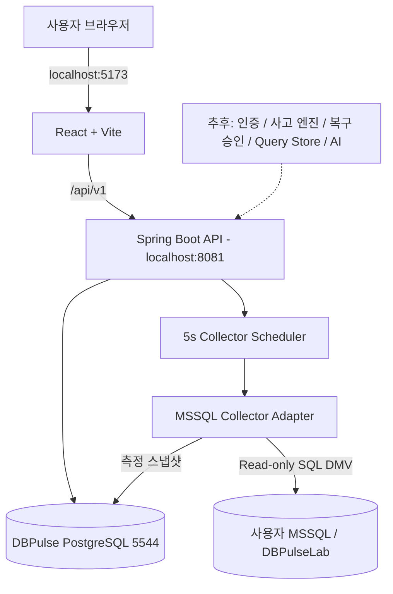

# DBPulse 아키텍처 v0.1.0

## v0.1.0 데이터 흐름
1. 수집기 스케줄러가 환경변수에 지정된 대상 DB에 JDBC로 접속한다.
2. `sys.dm_exec_requests`에서 대상 DB의 현재 실행 중 요청을 집계한다. 수집기 자신의 세션은 제외한다.
3. `active_requests`, `blocked_requests`, `long_running_requests`, `max_elapsed_ms`, `total_cpu_ms`의 시간별 스냅샷을 `metric_snapshots`에 기록한다.
4. 프론트엔드는 `/api/v1/targets` 및 `/api/v1/targets/{id}/metrics`를 3초 간격으로 조회한다. 미연결 상태에는 가짜 값을 표시하지 않는다.

## 엄격한 지표 정의
- Active requests: 샘플 시점에 `sys.dm_exec_requests`에서 확인된 요청 수. QPS/TPS가 아님.
- Blocked requests: 해당 샘플 시점에 `blocking_session_id > 0`인 요청 수. 단순 접속 수와 다름.
- Long-running: 샘플 시점 `total_elapsed_time >= slowThresholdMs`인 요청 수.
- Max elapsed: 현재 활성 요청의 최대 `total_elapsed_time`(밀리초).
- Total CPU ms: 샘플에 포함된 현재 요청들의 `cpu_time` 합계. SQL Server 전체 CPU 사용률이 아님.
- 수집 간격보다 짧은 쿼리는 DMV 샘플에 기록되지 않을 수 있으며, 완료 쿼리 성능 분석은 추후 Query Store로 보완한다.

## 중요한 경계
- 원천 DB에는 수집 테이블을 생성하거나 데이터를 수정하지 않는다.
- 메트릭 저장 DB는 기존 DataOps의 `dataops` PostgreSQL과 완전히 분리한다.
- 비밀번호는 PostgreSQL에 저장하지 않고 로컬 `.env`에서 Docker 컨테이너 환경변수로 전달한다(개발용 한정).
- 서비스 실행 시점부터 이미 만들어진 SQL Server 모니터링 권한만 사용하며 GRANT 문은 애플리케이션에서 실행하지 않는다.
- 인터넷 공개/타사 연결 전: 회원 인증, 서버측 SSRF 방어, DB 자격증명 암호화/회전, 권한 분리, TLS 검증, 네트워크 정책, 감사 로그, RATE 제한 등을 구현한다.

## 이후 DBMS 확장을 위한 설계
- `DatabaseCollector` 인터페이스에 MSSQL 구현을 연결한다.
- PostgreSQL 구현 시 수집 API/메트릭 저장 API/화면을 재사용하고, SQL과 DB 연결 계층만 교체한다.
- DBMS별로 제공 불가능한 지표를 숫자 0으로 대체하지 않으며 ‘지원하지 않음’으로 표시한다.

## 현재 단계 보안 메모
Docker Compose는 API와 PostgreSQL 포트를 `127.0.0.1`에만 바인딩한다. 프런트 개발 서버 역시 `127.0.0.1`에 바인딩한다. 모니터링 계정에는 데이터 수정 권한을 부여하지 않는다. SQL Server 로컬 자체 서명 인증서의 경우에만 개발 환경에서 `trustServerCertificate=true`를 사용할 수 있다.
