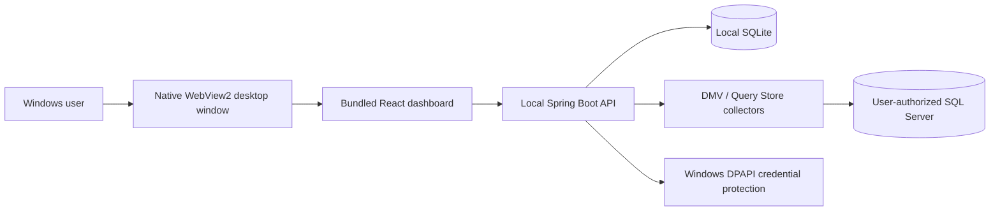

# DBPulse v0.21.2 — Release Overview

> Updated 2026-10-22. This document describes the public Windows installer. Older phase documents are historical engineering records rather than the current installation guide.

## Product

DBPulse is a **Windows-local SQL Server monitoring and diagnostic desktop application**. It presents a native WebView2 window hosting a local dashboard and Spring Boot API. It is not a hosted SaaS service and is not intended to be publicly exposed to the Internet.

## Main features

| Area | Implemented scope | Important boundary |
|---|---|---|
| Target management | Register, select, disconnect and reconnect an authorized SQL Server database | Explicit user action required to start monitoring; local single-active-target workflow |
| Live monitoring | Periodic DMV snapshots of active, blocked and long-running requests | Point-in-time samples, not QPS or full query audit |
| Incident diagnostics | Blocking chains, wait information, deadlock evidence and incident investigation | Diagnostics are evidence, not automatically proven root causes |
| Query performance | Query Store query/plan analysis, CPU time, execution counts, reads, query history and tuning candidates | Query Store configuration, rights and retention affect coverage |
| CPU | SQL Server instance CPU samples and selected-DB Query Store CPU workload indicator | Selected-DB indicator is **one-core-equivalent**, not exact per-DB utilization (%) |
| Local data protection | SQLite persistence, Windows DPAPI-protected saved credentials, local backup/recovery tooling | Protect private SQLite/DPAPI files; never upload them or SQL text |
| Desktop delivery | Windows x64 installer, integrated icon, larger adaptive startup window | Installer is **unsigned** and needs Microsoft Edge WebView2 Runtime |

SQL analysis provides read-only investigation and tuning advice. **It does not promise production-safe automated remediation, exact root-cause identification, or zero observer overhead.**

## Architecture



The project also retains Docker/PostgreSQL development and historical implementation paths. Those are **not** required to use the packaged Windows desktop installer.

## Download and install

1. Open [v0.21.2 GitHub Release](https://github.com/hanmj97/DBPulse/releases/tag/v0.21.2).
2. Download `DBPulse-Setup-v0.21.2.exe` and `SHA256SUMS.txt` (Windows x64).
3. With DBPulse closed, optionally check SHA-256 as below; then install. **Update in place**, without deleting existing local app data.
4. Launch DBPulse, explicitly select a registered target and start monitoring.
5. Review the target's required least-privilege SQL Server permissions and Query Store availability.

```powershell
# Change this to your actual download directory.
Set-Location "$HOME\Downloads"

# Calculate the executable checksum for comparison with SHA256SUMS.txt.
Get-FileHash -LiteralPath ".\DBPulse-Setup-v0.21.2.exe" -Algorithm SHA256

# Display the publisher-provided checksum; values must match.
Get-Content -LiteralPath ".\SHA256SUMS.txt"
```

SHA-256 verifies file integrity, **not publisher identity**. The EXE is not digitally signed. Follow your organization's endpoint security policy and do not override warnings on a machine you do not trust. Back up user data before upgrades; do not manually remove SQLite WAL/SHM files.

## Verification and limitations

The v0.21.2 release contains an installer and checksum generated by GitHub Actions. Prior focused test evidence covers desktop startup/exit, SQLite/DPAPI operations, installation integrity checks, and selected SQL Server lab flows. This is **not equivalent to** independent security certification or general production readiness.

**Not completed / not claimed:** 60-minute continuous soak (explicitly skipped), 24-hour durability test, broad clean-machine acceptance, full third-party security review, signed binaries, and proof of negligible workload overhead across customer SQL Server environments.

See [release readiness and deferred tests](RELEASE_READINESS_V021.md), [installation/data preservation](USER_INSTALL_GUIDE_V021.md), and the detailed [v0.21.2 release notes](https://github.com/hanmj97/DBPulse/releases/tag/v0.21.2).

## Privacy and safe operation

- Use only authorized SQL Server targets and least-privilege accounts.
- Keep the local API loopback-only. Do not expose the unauthenticated local application as a public service.
- Do not commit `.env`, local SQLite or WAL files, DPAPI secrets, backups, logs, XEL files, query text, or customer database exports.
- The monitoring app should not execute destructive SQL or unapproved recovery actions.
- This is an individually maintained engineering portfolio product with an available public evaluation build, **not an enterprise support or uptime guarantee**.
